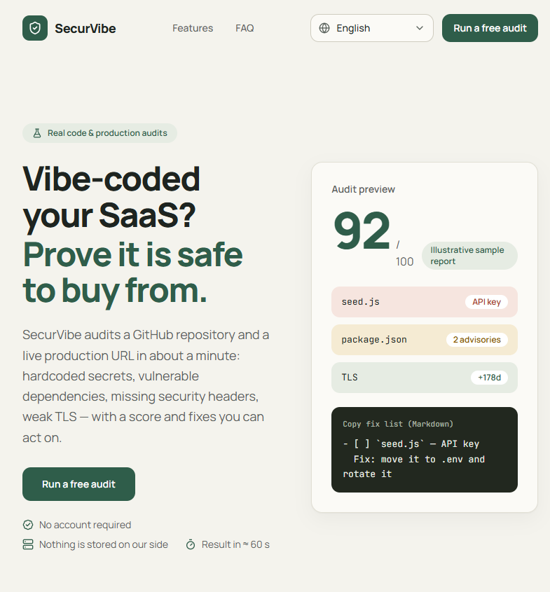

# SecurVibe

[](https://github.com/SammyYohan/SecurVibe/actions/workflows/ci.yml)
[](./LICENSE)
[](https://ko-fi.com/sammyyohan)
[](https://paypal.me/sammyyohan)

**تدقيقات أمنية حقيقية لخدمات SaaS المبنية بالذكاء الاصطناعي** — ماسح GitHub + تدقيق بيئة الإنتاج، في ≈ 60 ثانية، مجاني 100%، وبدون حساب.

▶️ **عرض مباشر**: [securvibe-theta.vercel.app](https://securvibe-theta.vercel.app/) — شغّل تدقيقًا مجانيًا واحكم بنفسك. بدون حساب.

[](https://securvibe-theta.vercel.app/)

🌍 [English](./README.md) | [Français](./README.fr.md) | [Español](./README.es.md) | [Deutsch](./README.de.md) | [Português (BR)](./README.pt-br.md) | [日本語](./README.ja.md) | [简体中文](./README.zh-cn.md) | **العربية**

> 🌐 الواجهة متوفرة بثماني لغات: English · Français · Español · Deutsch · Português (BR) · 日本語 · 简体中文 · العربية (RTL).
> ملاحظات التدقيق والإصلاحات تُكتب بالإنجليزية — وهو المعيار المتبع في أدوات الأمن — وتُعرض بهذا الشكل في جميع اللغات.

---

## لماذا بنيتُ SecurVibe

أنا **SammyYohan** — عملتُ مختصّ تقنية معلومات ومطوّرًا في السابق، ثم تحوّلتُ إلى أسلوب vibe coding: أي بناء البرمجيات يدًا بيد مع الذكاء الاصطناعي. أعيش في ليبرفيل (Libreville) بغابون (Gabon)، وأنا حاليًا خارج سوق العمل — وإنشاء المشاريع هو ما يدفعني للأمام. أنا شغوف بالذكاء الاصطناعي والتقنيات الجديدة والألعاب، ومن هذا المزيج تحديدًا وُلد SecurVibe.

المشكلة التي يحلّها: اليوم، الجميع يصدرون شيفرة كتبها الذكاء الاصطناعي — غالبًا منسوخة حرفيًا من نافذة محادثة — دون أي أداة تتحقّق مما يخرج. توجد أدوات أمنية قوية — منصات CI، وحزم SAST، ولوحات معلومات للمؤسسات — لكنها موجّهة إلى ميزانيات الشركات. بالنسبة للمطوّر المستقل (أو لمن هو خارج سوق العمل مثلي)، لم تكن هناك أي وسيلة مجانية، بلا تسجيل وبلا حساب، للإجابة عن سؤال بسيط واحد: *«هل ما بناه ذكائي الاصطناعي للتوّ آمن فعلًا للنشر؟»*

SecurVibe هو هذا الجواب: تدقيقات حقيقية (الأسرار، التبعيات الهشّة، TLS، رؤوس الأمان)، ودرجة تقييم، وقائمة إصلاحات جاهزة للّصق في أي وكيل برمجة — مجاني للجميع.

---

## فحوصات حقيقية (بلا محاكاة)

| الوحدة | ما الذي يُفحص | مصدر البيانات |
| --- | --- | --- |
| **ماسح المستودعات** | الأسرار المكتوبة ضمن الشيفرة (رموز PAT لـ GitHub، مفاتيح Stripe/OpenAI/Anthropic/Slack/GitLab، AWS، مفاتيح PEM الخاصة، رموز JWT الموقّعة، روابط قواعد البيانات)، ترتيب الأولويات حسب الخطر، حتى 200 ملف | المحتوى الحقيقي عبر `raw.githubusercontent.com` + رجوع إلى واجهة GitHub API |
| **التبعيات** | تنبيهات CVE/GHSA حقيقية مع درجة الشدة (OSV.dev) بناءً على الإصدارات الدقيقة المحلولة في ملفات القفل (`package-lock.json`، `pnpm-lock.yaml`، `yarn.lock`) | [OSV.dev](https://osv.dev) (عام ومجاني وبلا مفتاح) |
| **النظافة العامة** | ملفات `.env` المُودَعة في المستودع، واستبعاد `.env*` في `.gitignore`، وملفات القفل (lockfile)، وسير عمل CI، ومكتبات تجزئة كلمات المرور (bcrypt/argon2) | شجرة المستودع + الملفات |
| **تدقيق بيئة الإنتاج** | الوصول عبر HTTPS، إعادة توجيه HTTP→HTTPS، شهادة TLS (الأيام المتبقية، مصافحة حقيقية)، 6 رؤوس أمان (CSP، HSTS، X-Frame-Options، X-Content-Type-Options، Referrer-Policy، Permissions-Policy) | طلبات HTTP + `tls.connect` إلى الرابط المقدَّم |

**الدرجة**: `100 − 15 × حرجة − 5 × تحذير − 10 × (فشل خطوة حاسمة في تدقيق بيئة الإنتاج)`. أي ملاحظة حرجة تحدّ الدرجة عند 79. كل ملاحظة مصحوبة بشرح وإصلاح جاهز للّصق.

### حلقة الإصلاح (100% داخل المتصفح)

1. **«انسخ تعليمة الذكاء الاصطناعي»** (اختياري) — مراجعة من LLM (عبر [OpenRouter](https://openrouter.ai)) تحوّل الملاحظات إلى تحليل واضح وتعليمة واحدة جاهزة للّصق في وكيل البرمجة لديك.
2. **«انسخ قائمة الإصلاحات (Markdown)»** — قائمة تحقق جاهزة للّصق في Cursor / Claude Code / Copilot: كل ملاحظة تصبح عنصر `- [ ]` مع إصلاحها، ثم أعد التدقيق للتحقق.
3. **الاتجاه المحلي** — تُقارن الدرجة بالتدقيق السابق **على الهدف نفسه** (مستودع + رابط الإنتاج): `↗ +X` / `↘ −X` / `=`. يُحفظ السجل في `localStorage` (آخر 50 تدقيقًا، بلا بيانات على الخادم، ولا يُخزَّن الرمز مطلقًا).
4. **«أعد التدقيق بعد الإصلاحات»** — إعادة تشغيل للهدف نفسه بالمعاملات نفسها بنقرة واحدة.

---

## التقنيات المستخدمة

> 🎨 نظام التصميم (لوحة الألوان، الخطوط، المكوّنات) موثّق في [`DESIGN.md`](./DESIGN.md).

- **Next.js 16** (App Router، RSC)، **React 19**، **TypeScript strict**
- **Tailwind CSS v4**، lucide-react، ومكوّنات واجهة مطوّرة داخليًا (بلا مكتبات خارجية ثقيلة)
- **zod** لكل العُقود (مخططات مشتركة بين العميل/الخادم)
- بث **NDJSON** مع إلغاء يتّسلسل (`AbortSignal`/`AbortSignal.any`)
- بلا قاعدة بيانات، بلا حسابات، بلا تخزين على الخادم
- الحصص عبر **Upstash Redis** (REST API بلا حالة) مع رجوع تلقائي إلى الذاكرة
- pnpm فقط (Node ≥ 20.9)

```bash
corepack enable && corepack prepare pnpm@latest --activate
pnpm install
pnpm dev          # development
pnpm build && pnpm start
pnpm lint && pnpm typecheck
```

---

## بنية المشروع

```
src/
├── app/
│   ├── [locale]/
│   │   ├── layout.tsx          ← root layout (lang/dir RTL, hreflang SEO)
│   │   ├── page.tsx            ← landing (hero, benefits, comparison, FAQ)
│   │   ├── pricing/page.tsx    ← permanent redirect to /app (product is free)
│   │   ├── legal/page.tsx      ← terms & privacy
│   │   ├── app/page.tsx        ← dashboard (scanner)
│   │   ├── error.tsx           ← localized error boundary
│   │   └── not-found.tsx
│   ├── api/scan/route.ts       ← POST NDJSON streaming (real, quotas, slots)
│   ├── api/ai-analysis/route.ts← POST optional AI review (OpenRouter)
│   └── globals.css
├── components/
│   ├── dashboard/              ← Dashboard, ScanForm, ScanStatus, SecurityReport,
│   │                             SiteAuditPanel
│   ├── site/                   ← LocaleSwitcher, SiteFooter, Logo, SectionHeading
│   └── ui/                     ← in-house primitives (Button, Badge, Card, Input…)
├── lib/
│   ├── i18n/                   ← locale config, 8 typed dictionaries, engine
│   ├── env.ts                  ← validated server variables (zod)
│   ├── validation.ts           ← shared request schemas (zod)
│   ├── score.ts                ← score formula (capped at 79 on critical)
│   ├── rateLimit.ts            ← per-instance in-memory limiter
│   ├── quota.ts                ← shared Upstash Redis quotas + memory fallback
│   ├── lockfile.ts             ← npm/pnpm/yarn lock version resolver
│   ├── secrets.ts              ← secret detection rules & guidance
│   ├── ssrf.ts                 ← anti-SSRF URL validation (DNS, private IPs)
│   └── plans.ts                ← quota constants and audit limits
├── services/
│   ├── scanService.ts          ← repository scanner (GitHub raw + rules + OSV.dev)
│   ├── siteService.ts          ← production audit (HTTPS, TLS, headers)
│   └── vulnClient.ts           ← OSV.dev client (batch + severity)
├── types/index.ts              ← zod contracts (ScanEvent, Finding, TestStep…)
└── proxy.ts                    ← Accept-Language negotiated redirect (Next 16)
```

---

## نموذج العمل وحصص الاستخدام العادل

SecurVibe **مجاني 100% — بلا تسجيل، بلا إعلانات، بلا تيليمتري**.

حصص الاستخدام العادل تحمي البنية التحتية وتبقيها متاحة للجميع:

| الحصة | الحد | الوصف |
| --- | --- | --- |
| **كل دقيقة** | 6 تدقيقات | نافذة منزلقة لكل IP (حماية من الاندفاعات) |
| **كل يوم** | 30 تدقيقًا | لكل IP، ولكل شريحة UTC من 24 ساعة |
| **السقف العام** | 1,000 تدقيق | يوميًا للخدمة بأكملها |
| **التزامن** | 3 متزامنة | لكل نسخة خادم (ضابط للذاكرة/CPU) |
| **العمق** | 200 ملف | لكل تدقيق لمستودع GitHub |

تُفحَص الحصص عبر Upstash Redis (خط أنابيب REST، مفاتيح تبدأ بالبادئة `sv:`) وتتراجع تلقائيًا إلى الذاكرة المحلية عندما يتعذّر الوصول إلى المخزن («fail-open»).

---

## الإعدادات

كل المتغيرات **اختيارية** (انظر [`.env.example`](./.env.example)):

| المتغير | الغرض |
| --- | --- |
| `GITHUB_TOKEN` | حصة على الخادم 60→5,000 طلب/ساعة عندما لا يقدّم المستخدم رمزه الخاص |
| `UPSTASH_REDIS_REST_URL` & `UPSTASH_REDIS_REST_TOKEN` | مخزن الحصص المشترك (Upstash، REST API) |
| `OPENROUTER_API_KEY` | اختياري: يفعّل مراجعة «حلّل بالذكاء الاصطناعي» في التقرير |
| `OPENROUTER_MODEL` | اختياري: نموذج المراجعة (الافتراضي: `openai/gpt-4o-mini`) |
| `NEXT_PUBLIC_SITE_URL` | الرابط الرسمي + hreflang (ويُستخدم أيضًا كـ `HTTP-Referer` لـ OpenRouter) |
| `CONTACT_EMAIL` | عنوان التواصل المعروض في الصفحة القانونية |

**رمز المستخدم**: حقل اختياري في نموذج الفحص، يُمرَّر للطلب الحالي فقط، ولا يُخزَّن مطلقًا على الخادم أو العميل.

---

## أمن المنتج

- **حماية صارمة ضد SSRF** (`ssrf.ts`): تحقّق من عمليات ترجمة أسماء DNS، وحجب النطاقات الخاصة (10.0.0.0/8، 172.16.0.0/12، 192.168.0.0/16، 127.0.0.0/8، link-local، multicast، بيانات وصفية سحابية IPv4/IPv6)، واتصالات بعناوين IP مثبّتة لتحييد هجمات DNS rebinding.
- تحقّق صارم **قبل** أي بث (خطأ JSON 400 دون تسرّب الـ stack trace).
- كل متغيرات البيئة تُقرأ عبر مخطط zod؛ والأسرار لا تُكشف مطلقًا عبر `NEXT_PUBLIC_`.
- محددات معدل متعددة الطبقات (دقيقة، يوم، تزامن، عام).
- إلغاء نظيف للبث عبر `AbortSignal`.

---

## النشر (Vercel + Upstash)

1. `pnpm build` (توليد مسبق وثابت للصفحات للغات الثماني).
2. عيّن متغيرات البيئة الاختيارية على مزوّد استضافتك (Vercel أو Node).
3. للحصص المشتركة: [Upstash](https://upstash.com) → أنشئ قاعدة بيانات Redis (مع تفعيل REST) → انسخ `UPSTASH_REDIS_REST_URL` و `UPSTASH_REDIS_REST_TOKEN`.
4. كل شيء جاهز: i18n، وتحسين محركات البحث (hreflang + رابط رسمي)، والحماية من SSRF، وبث NDJSON (قيمة `maxDuration = 60` مضبوطة مسبقًا لـ `/api/scan`).

---

## المساهمة

المساهمات مرحّب بها:

1. استنسخ المشروع (Fork) وأنشئ فرعًا من `main`.
2. `pnpm install` (Node ≥ 20.9، وpnpm عبر corepack).
3. `pnpm dev` لتشغيل التطبيق محليًا — `/en/app` هي لوحة التحكم.
4. أبقِ الـ CI خضراء: `pnpm typecheck && pnpm lint && pnpm build` (تُنفَّذ عند كل push/PR — انظر `.github/workflows/ci.yml`).
5. تُكتب التعليقات بالإنجليزية؛ والنصوص الموجّهة للمستخدمين تمر عبر القواميس الثمانية في `src/lib/i18n/dictionaries/`.
6. افتح PR بوصف واضح.

---

## التفرع (Forking)

تفرّع SecurVibe لنشره بنفسك هو بالضبط ما صُمّم ترخيص MIT من أجله: احفظ ملف [`LICENSE`](./LICENSE)، وانشر نسختك الخاصة، وابقَ مجانيًا 100% لمستخدميك — فلا تُبنى داخله أي آليات لجدار الدفع.

---

## ادعم عملي

SecurVibe مجاني 100% وسيبقى كذلك. إذا وفّر عليك وقتًا — أو إذا أعجبك ببساطة ما أبنيه — يمكنك دعم عملي عبر [Ko-fi](https://ko-fi.com/sammyyohan) أو [PayPal.me](https://paypal.me/sammyyohan).

كل تبرّع يذهب إلى تكاليف استضافة هذه الأداة، وإلى المشروع المجاني القادم. الأمر اختياري تمامًا: لا شيء مقفل خلفه، والأداة مكتملة من دونه.

---

## الترخيص

[MIT](./LICENSE) — حرّ في الاستخدام والتعديل وإعادة التوزيع.
