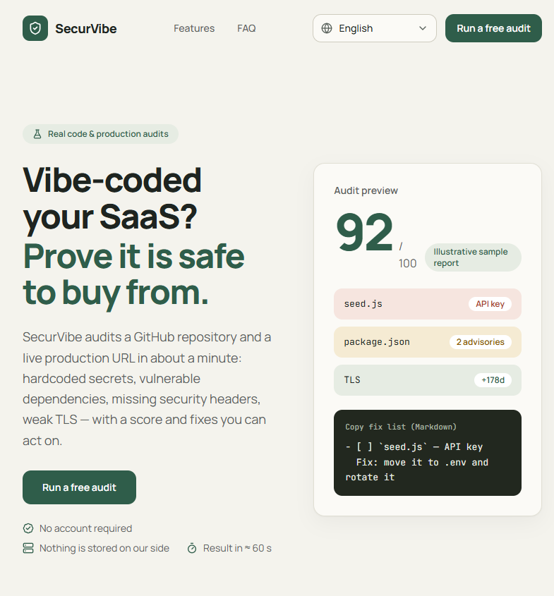

# SecurVibe

[](https://github.com/SammyYohan/SecurVibe/actions/workflows/ci.yml)
[](./LICENSE)
[](https://ko-fi.com/sammyyohan)
[](https://paypal.me/sammyyohan)

**Echte Sicherheitsaudits für mit KI gebaute SaaS** — GitHub-Scanner + Produktions-Audit, in ≈ 60 Sekunden, 100 % kostenlos, ohne Konto.

▶️ **Live-Demo**: [securvibe-theta.vercel.app](https://securvibe-theta.vercel.app/) — starte ein kostenloses Audit und bilde dir dein eigenes Urteil. Ohne Konto.

[](https://securvibe-theta.vercel.app/)

🌍 [English](./README.md) | [Français](./README.fr.md) | [Español](./README.es.md) | **Deutsch** | [Português (BR)](./README.pt-br.md) | [日本語](./README.ja.md) | [简体中文](./README.zh-cn.md) | [العربية](./README.ar.md)

> 🌐 Oberfläche in 8 Sprachen verfügbar: English · Français · Español · Deutsch · Português (BR) · 日本語 · 简体中文 · العربية (RTL).
> Audit-Funde und Fixes sind auf Englisch — der Standard bei Security-Tools — und werden in jeder Sprache angezeigt.

---

## Warum ich SecurVibe gebaut habe

Ich bin **SammyYohan** — ein ehemaliger IT-Profi und Entwickler, der zum Vibe Coding gewechselt ist: Software Hand in Hand mit der KI bauen. Ich lebe in Libreville, Gabun, und bin zurzeit ohne Anstellung — Projekte zu bauen ist das, was mich voranbringt. Meine Leidenschaft sind KI, neue Technologien und Gaming — und genau aus dieser Mischung ist SecurVibe entstanden.

Das Problem, das es löst: Heute schreibt jeder Code mit KI, meist direkt aus einem Chat-Fenster, und es fehlen Werkzeuge, um zu prüfen, was dabei herauskommt. Solides Security-Tooling existiert — CI-Plattformen, SAST-Suiten, Unternehmens-Dashboards —, aber es richtet sich an Unternehmensbudgets. Für einen Indie-Dev (oder jemanden ohne Anstellung wie mich) gab es keinen kostenlosen, registrierungsfreien, kontofreien Weg, eine ganz einfache Frage zu beantworten: *„Ist das, was meine KI gerade gebaut hat, wirklich sicher genug zum Ausliefern?“*

SecurVibe ist diese Antwort: echte Audits (Secrets, verwundbare Abhängigkeiten, TLS, Security-Header), ein Score und eine Fix-Liste, bereit zum Einfügen in jeden Coding-Agent — kostenlos für alle.

---

## Echte Prüfungen (keine Simulation)

| Modul | Was geprüft wird | Datenquelle |
| --- | --- | --- |
| **Repository-Scanner** | Fest im Code verankerte Secrets (GitHub-PATs, Stripe-/OpenAI-/Anthropic-/Slack-/GitLab-Schlüssel, AWS, private PEM-Schlüssel, signierte JWTs, Datenbank-URLs), Priorisierung nach Risiko, bis zu 200 Dateien | Echter Inhalt über `raw.githubusercontent.com` + GitHub-API-Fallback |
| **Abhängigkeiten** | Echte CVE/GHSA-Advisories mit Schweregrad (OSV.dev) für die exakt im Lockfile aufgelösten Versionen (`package-lock.json`, `pnpm-lock.yaml`, `yarn.lock`) | [OSV.dev](https://osv.dev) (öffentlich, kostenlos, ohne Schlüssel) |
| **Hygiene** | Committete `.env`-Dateien, Ausschluss von `.env*` in `.gitignore`, Lockfile, CI-Workflows, Bibliotheken zum Passwort-Hashing (bcrypt/argon2) | Repository-Baum + Dateien |
| **Produktions-Audit** | HTTPS-Erreichbarkeit, HTTP→HTTPS-Umleitung, TLS-Zertifikat (verbleibende Tage, echter Handshake), 6 Security-Header (CSP, HSTS, X-Frame-Options, X-Content-Type-Options, Referrer-Policy, Permissions-Policy) | HTTP-Anfragen + `tls.connect` zur übermittelten URL |

**Score**: `100 − 15 × kritische Funde − 5 × Warnungen − 10 × (Fehlschlag eines entscheidenden Schritts des Produktions-Audits)`. Ein kritischer Befund begrenzt den Score auf maximal 79. Jeder Befund enthält eine Erklärung und einen Fix zum direkten Kopieren und Einfügen.

### Fix-Schleife (100 % im Browser)

1. **„KI-Anweisung kopieren“** (optional) — ein LLM-Review (via [OpenRouter](https://openrouter.ai)) macht aus den Funden eine klare Analyse und eine Copy-and-Paste-Anweisung für deinen Coding-Agent.
2. **„Fix-Liste kopieren (Markdown)“** — eine einfügebereite Checkliste für Cursor / Claude Code / Copilot: jeder Befund wird zu einem `- [ ]`-Eintrag mit seinem Fix, danach wird erneut auditiert, um alles zu verifizieren.
3. **Lokaler Trend** — der Score wird mit dem vorherigen Audit **für dasselbe Ziel** (Repo + Produktions-URL) verglichen: `↗ +X` / `↘ −X` / `=`. Der Verlauf liegt in `localStorage` (letzte 50 Audits, keine Serverdaten, niemals der Token).
4. **„Re-Audit nach Fixes“** — ein Klick startet dasselbe Ziel mit denselben Parametern erneut.

---

## Stack

> 🎨 Das Designsystem (Palette, Typografie, Komponenten) ist in [`DESIGN.md`](./DESIGN.md) dokumentiert.

- **Next.js 16** (App Router, RSC), **React 19**, **TypeScript strict**
- **Tailwind CSS v4**, lucide-react, eigene UI-Komponenten (keine schwergewichtige externe Library)
- **zod** für sämtliche Contracts (Schemas, geteilt zwischen Client/Server)
- **NDJSON**-Streaming mit fortgeleiteter Abbruchanforderung (`AbortSignal`/`AbortSignal.any`)
- Keine Datenbank, kein Konto, keine serverseitige Speicherung
- Quotas über **Upstash Redis** (zustandslose REST-API) mit automatischem In-Memory-Fallback
- Nur pnpm (Node ≥ 20.9)

```bash
corepack enable && corepack prepare pnpm@latest --activate
pnpm install
pnpm dev          # development
pnpm build && pnpm start
pnpm lint && pnpm typecheck
```

---

## Struktur

```
src/
├── app/
│   ├── [locale]/
│   │   ├── layout.tsx          ← root layout (lang/dir RTL, hreflang SEO)
│   │   ├── page.tsx            ← landing (hero, benefits, comparison, FAQ)
│   │   ├── pricing/page.tsx    ← permanent redirect to /app (product is free)
│   │   ├── legal/page.tsx      ← terms & privacy
│   │   ├── app/page.tsx        ← dashboard (scanner)
│   │   ├── error.tsx           ← localized error boundary
│   │   └── not-found.tsx
│   ├── api/scan/route.ts       ← POST NDJSON streaming (real, quotas, slots)
│   ├── api/ai-analysis/route.ts← POST optional AI review (OpenRouter)
│   └── globals.css
├── components/
│   ├── dashboard/              ← Dashboard, ScanForm, ScanStatus, SecurityReport,
│   │                             SiteAuditPanel
│   ├── site/                   ← LocaleSwitcher, SiteFooter, Logo, SectionHeading
│   └── ui/                     ← in-house primitives (Button, Badge, Card, Input…)
├── lib/
│   ├── i18n/                   ← locale config, 8 typed dictionaries, engine
│   ├── env.ts                  ← validated server variables (zod)
│   ├── validation.ts           ← shared request schemas (zod)
│   ├── score.ts                ← score formula (capped at 79 on critical)
│   ├── rateLimit.ts            ← per-instance in-memory limiter
│   ├── quota.ts                ← shared Upstash Redis quotas + memory fallback
│   ├── lockfile.ts             ← npm/pnpm/yarn lock version resolver
│   ├── secrets.ts              ← secret detection rules & guidance
│   ├── ssrf.ts                 ← anti-SSRF URL validation (DNS, private IPs)
│   └── plans.ts                ← quota constants and audit limits
├── services/
│   ├── scanService.ts          ← repository scanner (GitHub raw + rules + OSV.dev)
│   ├── siteService.ts          ← production audit (HTTPS, TLS, headers)
│   └── vulnClient.ts           ← OSV.dev client (batch + severity)
├── types/index.ts              ← zod contracts (ScanEvent, Finding, TestStep…)
└── proxy.ts                    ← Accept-Language negotiated redirect (Next 16)
```

---

## Geschäftsmodell & Fair-Use-Quotas

SecurVibe ist **100 % kostenlos — keine Registrierung, keine Werbung, keine Telemetrie**.

Fair-Use-Quotas schützen die Infrastruktur und halten sie für alle verfügbar:

| Quota | Limit | Beschreibung |
| --- | --- | --- |
| **Pro Minute** | 6 Audits | Gleitendes Fenster pro IP (Burst-Schutz) |
| **Pro Tag** | 30 Audits | Pro IP und pro UTC-24-h-Fenster |
| **Globales Limit** | 1.000 Audits | Pro Tag für den gesamten Dienst |
| **Parallelität** | 3 gleichzeitig | Pro Serverinstanz (Speicher-/CPU-Schutz) |
| **Tiefe** | 200 Dateien | Pro Audit eines GitHub-Repositorys |

Die Quotas werden über Upstash Redis geprüft (REST-Pipeline, Schlüssel mit dem Präfix `sv:`) und weichen automatisch auf lokalen Speicher aus, wenn der Store nicht erreichbar ist („fail-open“).

---

## Konfiguration

Alle Variablen sind **optional** (siehe [`.env.example`](./.env.example)):

| Variable | Zweck |
| --- | --- |
| `GITHUB_TOKEN` | Serverseitige Quote 60→5.000 Anfragen/h, wenn der Nutzer keine eigene angibt |
| `UPSTASH_REDIS_REST_URL` & `UPSTASH_REDIS_REST_TOKEN` | Gemeinsamer Quota-Speicher (Upstash, REST-API) |
| `OPENROUTER_API_KEY` | Optional: aktiviert die „Mit KI analysieren“-Prüfung im Report |
| `OPENROUTER_MODEL` | Optional: Modell der Prüfung (Standard: `openai/gpt-4o-mini`) |
| `NEXT_PUBLIC_SITE_URL` | Kanonische URL + hreflang (auch OpenRouters `HTTP-Referer`) |
| `CONTACT_EMAIL` | Kontaktadresse, die auf der Seite „Rechtliches“ angezeigt wird |

**Nutzer-Token**: optionales Feld im Scan-Formular, wird nur für die aktuelle Anfrage weitergeleitet und niemals server- oder clientseitig gespeichert.

---

## Produktsicherheit

- **Strikter Anti-SSRF-Schutz** (`ssrf.ts`): Prüfung der DNS-Auflösungen, Blockierung privater Bereiche (10.0.0.0/8, 172.16.0.0/12, 192.168.0.0/16, 127.0.0.0/8, link-local, Multicast, Cloud-Metadaten IPv4/IPv6), Verbindungen über gepinnte IPs zum Neutralisieren von DNS-Rebinding.
- Strikte Validierung **vor** jedem Streaming (JSON 400 ohne Stacktrace-Leaks).
- Alle Umgebungsvariablen werden über ein zod-Schema gelesen; Secrets werden nie über `NEXT_PUBLIC_` offengelegt.
- Limiter in mehreren Ebenen (Minute, Tag, Parallelität, global).
- Sauberer Abbruch der Streams über `AbortSignal`.

---

## Deployment (Vercel + Upstash)

1. `pnpm build` (Seiten werden für die 8 Sprachen statisch vorgerendert).
2. Die optionalen Umgebungsvariablen auf deinem Host setzen (Vercel oder Node).
3. Für gemeinsame Quotas: [Upstash](https://upstash.com) → eine Redis-Datenbank anlegen (REST aktiviert) → `UPSTASH_REDIS_REST_URL` und `UPSTASH_REDIS_REST_TOKEN` kopieren.
4. Alles ist bereit: i18n, SEO (hreflang + kanonisch), Anti-SSRF, NDJSON-Streaming (`maxDuration = 60` ist für `/api/scan` gesetzt).

---

## Mitwirken

Beiträge sind willkommen:

1. Forke das Projekt und erstelle einen Branch von `main` aus.
2. `pnpm install` (Node ≥ 20.9, pnpm über corepack).
3. `pnpm dev` für die lokale App — `/en/app` ist das Dashboard.
4. Halte die CI grün: `pnpm typecheck && pnpm lint && pnpm build` (läuft bei jedem Push/PR — siehe `.github/workflows/ci.yml`).
5. Kommentare werden auf Englisch verfasst; nutzergerichtete Texte laufen durch die 8 Dictionaries in `src/lib/i18n/dictionaries/`.
6. Öffne eine PR mit einer klaren Beschreibung.

---

## Forken

SecurVibe für dein eigenes Deployment zu forken ist genau das, wofür die MIT-Lizenz da ist: behalte die [`LICENSE`](./LICENSE)-Datei, deploye deine eigene Instanz und bleibe 100 % kostenlos für deine Nutzer — es ist keine Paywall-Mechanik eingebaut.

---

## Unterstütze meine Arbeit

SecurVibe ist 100 % kostenlos und wird es auch bleiben. Wenn es dir Zeit gespart hat — oder du magst einfach, was ich baue — kannst du meine Arbeit auf [Ko-fi](https://ko-fi.com/sammyyohan) oder [PayPal.me](https://paypal.me/sammyyohan) unterstützen.

Jede Spende deckt die Hosting-Kosten dieses Tools und des nächsten kostenlosen Projekts. Komplett optional: nichts ist dahinter gesperrt, das Tool ist vollständig ohne die Spende.

---

## Lizenz

[MIT](./LICENSE) — frei zu nutzen, zu ändern und weiterzuverbreiten.
