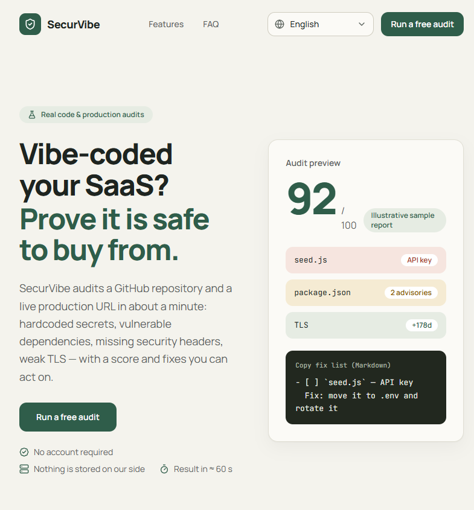

# SecurVibe

[](https://github.com/SammyYohan/SecurVibe/actions/workflows/ci.yml)
[](./LICENSE)
[](https://ko-fi.com/sammyyohan)
[](https://paypal.me/sammyyohan)

**Auditorías de seguridad reales para SaaS creados con IA** — escáner de GitHub + auditoría de producción, en ≈ 60 segundos, 100 % gratuito, sin cuenta.

▶️ **Demo en vivo**: [securvibe-theta.vercel.app](https://securvibe-theta.vercel.app/) — lanza una auditoría gratuita y saca tus propias conclusiones. Sin cuenta.

[](https://securvibe-theta.vercel.app/)

🌍 [English](./README.md) | [Français](./README.fr.md) | **Español** | [Deutsch](./README.de.md) | [Português (BR)](./README.pt-br.md) | [日本語](./README.ja.md) | [简体中文](./README.zh-cn.md) | [العربية](./README.ar.md)

> 🌐 Interfaz disponible en 8 idiomas: English · Français · Español · Deutsch · Português (BR) · 日本語 · 简体中文 · العربية (RTL).
> Los hallazgos de auditoría y las correcciones están en inglés — el estándar de las herramientas de seguridad — y se muestran en todos los idiomas.

---

## Por qué creé SecurVibe

Soy **SammyYohan** — un ex profesional de TI y desarrollador que se pasó al vibe coding: construir software de la mano con la IA. Vivo en Libreville, Gabón, y actualmente estoy sin empleo — crear proyectos es lo que me mantiene en marcha. Me apasionan la IA, las nuevas tecnologías y los videojuegos, y de esa mezcla nació exactamente SecurVibe.

El problema que resuelve: hoy todo el mundo publica código escrito con IA, casi siempre directamente desde una ventana de chat, sin ninguna herramienta para verificar lo que sale de ahí. Existen herramientas de seguridad sólidas — plataformas de CI, suites SAST, paneles corporativos — pero están pensadas para presupuestos de empresa. Para un desarrollador independiente (o alguien sin empleo como yo), no había una forma gratuita, sin registro y sin cuenta de responder a una pregunta muy simple: *«¿Es lo que mi IA acaba de construir realmente seguro para publicar?»*

SecurVibe es la respuesta: auditorías reales (secretos, dependencias vulnerables, TLS, cabeceras de seguridad), una puntuación y una lista de correcciones lista para pegar en cualquier agente de código — gratis para todo el mundo.

---

## Verificaciones reales (sin simulación)

| Módulo | Qué se comprueba | Fuente de datos |
| --- | --- | --- |
| **Escáner de repositorio** | Secretos incrustados en el código (PATs de GitHub, claves de Stripe/OpenAI/Anthropic/Slack/GitLab, AWS, claves PEM privadas, JWT firmados, URLs de bases de datos), priorización por riesgo, hasta 200 archivos | Contenido real vía `raw.githubusercontent.com` + respaldo en la API de GitHub |
| **Dependencias** | Avisos CVE/GHSA reales con nivel de gravedad (OSV.dev) para las versiones exactas resueltas en el lockfile (`package-lock.json`, `pnpm-lock.yaml`, `yarn.lock`) | [OSV.dev](https://osv.dev) (base pública gratuita, sin clave) |
| **Higiene** | Archivos `.env` incluidos en el repositorio, exclusión `.env*` en `.gitignore`, lockfile, workflows de CI, bibliotecas de hash de contraseñas (bcrypt/argon2) | Árbol del repositorio + archivos |
| **Auditoría de producción** | Accesibilidad HTTPS, redirección HTTP→HTTPS, certificado TLS (días restantes, handshake real), 6 cabeceras de seguridad (CSP, HSTS, X-Frame-Options, X-Content-Type-Options, Referrer-Policy, Permissions-Policy) | Peticiones HTTP + `tls.connect` a la URL enviada |

**Puntuación**: `100 − 15 × críticos − 5 × avisos − 10 × (fallo de la etapa decisiva de la auditoría de producción)`. Un hallazgo crítico limita la puntuación a 79. Cada hallazgo incluye una explicación y una corrección lista para copiar y pegar.

### Ciclo de corrección (100 % en el navegador)

1. **«Copiar la instrucción para la IA»** (opcional) — una revisión por LLM (vía [OpenRouter](https://openrouter.ai)) convierte los hallazgos en un análisis claro y una única instrucción lista para pegar en tu agente de código.
2. **«Copiar la lista de correcciones (Markdown)»** — una checklist lista para pegar en Cursor / Claude Code / Copilot: cada hallazgo se convierte en un elemento `- [ ]` con su corrección, y después se re-audita para verificar.
3. **Tendencia local** — la puntuación se compara con la auditoría anterior **en el mismo objetivo** (repo + URL de producción): `↗ +X` / `↘ −X` / `=`. El historial vive en `localStorage` (últimas 50 auditorías, sin datos en el servidor, nunca el token).
4. **«Reauditar tras las correcciones»** — un clic vuelve a lanzar el mismo objetivo con los mismos parámetros.

---

## Stack

> 🎨 El sistema de diseño (paleta, tipografía, componentes) está documentado en [`DESIGN.md`](./DESIGN.md).

- **Next.js 16** (App Router, RSC), **React 19**, **TypeScript strict**
- **Tailwind CSS v4**, lucide-react, componentes de UI propios (sin bibliotecas externas pesadas)
- **zod** para todos los contratos (schemas compartidos cliente/servidor)
- Streaming **NDJSON** con cancelación propagada (`AbortSignal`/`AbortSignal.any`)
- Sin base de datos, sin cuenta, sin almacenamiento en el servidor
- Cuotas vía **Upstash Redis** (API REST sin estado) con respaldo automático en memoria
- Solo pnpm (Node ≥ 20.9)

```bash
corepack enable && corepack prepare pnpm@latest --activate
pnpm install
pnpm dev          # development
pnpm build && pnpm start
pnpm lint && pnpm typecheck
```

---

## Estructura

```
src/
├── app/
│   ├── [locale]/
│   │   ├── layout.tsx          ← root layout (lang/dir RTL, hreflang SEO)
│   │   ├── page.tsx            ← landing (hero, benefits, comparison, FAQ)
│   │   ├── pricing/page.tsx    ← permanent redirect to /app (product is free)
│   │   ├── legal/page.tsx      ← terms & privacy
│   │   ├── app/page.tsx        ← dashboard (scanner)
│   │   ├── error.tsx           ← localized error boundary
│   │   └── not-found.tsx
│   ├── api/scan/route.ts       ← POST NDJSON streaming (real, quotas, slots)
│   ├── api/ai-analysis/route.ts← POST optional AI review (OpenRouter)
│   └── globals.css
├── components/
│   ├── dashboard/              ← Dashboard, ScanForm, ScanStatus, SecurityReport,
│   │                             SiteAuditPanel
│   ├── site/                   ← LocaleSwitcher, SiteFooter, Logo, SectionHeading
│   └── ui/                     ← in-house primitives (Button, Badge, Card, Input…)
├── lib/
│   ├── i18n/                   ← locale config, 8 typed dictionaries, engine
│   ├── env.ts                  ← validated server variables (zod)
│   ├── validation.ts           ← shared request schemas (zod)
│   ├── score.ts                ← score formula (capped at 79 on critical)
│   ├── rateLimit.ts            ← per-instance in-memory limiter
│   ├── quota.ts                ← shared Upstash Redis quotas + memory fallback
│   ├── lockfile.ts             ← npm/pnpm/yarn lock version resolver
│   ├── secrets.ts              ← secret detection rules & guidance
│   ├── ssrf.ts                 ← anti-SSRF URL validation (DNS, private IPs)
│   └── plans.ts                ← quota constants and audit limits
├── services/
│   ├── scanService.ts          ← repository scanner (GitHub raw + rules + OSV.dev)
│   ├── siteService.ts          ← production audit (HTTPS, TLS, headers)
│   └── vulnClient.ts           ← OSV.dev client (batch + severity)
├── types/index.ts              ← zod contracts (ScanEvent, Finding, TestStep…)
└── proxy.ts                    ← Accept-Language negotiated redirect (Next 16)
```

---

## Modelo de negocio & cuotas de uso razonable

SecurVibe es **100 % gratuito — sin registro, sin anuncios, sin telemetría**.

Las cuotas de uso razonable protegen la infraestructura y la mantienen disponible para todos:

| Cuota | Límite | Descripción |
| --- | --- | --- |
| **Por minuto** | 6 auditorías | Ventana deslizante por IP (protección anti-ráfagas) |
| **Por día** | 30 auditorías | Por IP y por franja UTC de 24 h |
| **Techo global** | 1 000 auditorías | Por día para todo el servicio |
| **Concurrencia** | 3 simultáneas | Por instancia del servidor (protección de memoria/CPU) |
| **Profundidad** | 200 archivos | Por auditoría de repositorio de GitHub |

Las cuotas se comprueban a través de Upstash Redis (pipeline de la API REST, claves con el prefijo `sv:`) y recurren automáticamente a la memoria local cuando el almacén no está disponible («fail-open»).

---

## Configuración

Todas las variables son **opcionales** (ver [`.env.example`](./.env.example)):

| Variable | Función |
| --- | --- |
| `GITHUB_TOKEN` | Cuota del servidor 60→5 000 solicitudes/h cuando el usuario no proporciona la suya |
| `UPSTASH_REDIS_REST_URL` & `UPSTASH_REDIS_REST_TOKEN` | Almacén compartido de cuotas (Upstash, API REST) |
| `OPENROUTER_API_KEY` | Opcional: activa la revisión «Analizar con IA» en el informe |
| `OPENROUTER_MODEL` | Opcional: modelo de la revisión (por defecto: `openai/gpt-4o-mini`) |
| `NEXT_PUBLIC_SITE_URL` | URL canónica + hreflang (también el `HTTP-Referer` de OpenRouter) |
| `CONTACT_EMAIL` | Dirección de contacto que se muestra en la página legal |

**Token del usuario**: campo opcional en el formulario de escaneo, se envía solo para la solicitud en curso y nunca se almacena del lado del servidor ni del cliente.

---

## Seguridad del producto

- Protección **anti-SSRF estricta** (`ssrf.ts`): comprobación de las resoluciones DNS, bloqueo de rangos privados (10.0.0.0/8, 172.16.0.0/12, 192.168.0.0/16, 127.0.0.0/8, link-local, multicast, metadatos cloud IPv4/IPv6), conexiones con IP fijada para neutralizar el DNS rebinding.
- Validación estricta **antes** de cualquier streaming (JSON 400 sin fugas de stack trace).
- Todas las variables de entorno se leen a través de un esquema zod; los secretos nunca se exponen vía `NEXT_PUBLIC_`.
- Limitadores en capas (minuto, día, concurrencia, global).
- Cancelación limpia de los flujos vía `AbortSignal`.

---

## Despliegue (Vercel + Upstash)

1. `pnpm build` (páginas pregeneradas estáticamente para los 8 idiomas).
2. Configura las variables de entorno opcionales en tu hosting (Vercel o Node).
3. Para las cuotas compartidas: [Upstash](https://upstash.com) → crea una base de datos Redis (REST activado) → copia `UPSTASH_REDIS_REST_URL` y `UPSTASH_REDIS_REST_TOKEN`.
4. Todo está listo: i18n, SEO (hreflang + canónico), anti-SSRF, streaming NDJSON (`maxDuration = 60` está configurado para `/api/scan`).

---

## Contribuir

Las contribuciones son bienvenidas:

1. Haz un fork y crea una rama desde `main`.
2. `pnpm install` (Node ≥ 20.9, pnpm vía corepack).
3. `pnpm dev` para la aplicación local — `/en/app` es el dashboard.
4. Mantén la CI en verde: `pnpm typecheck && pnpm lint && pnpm build` (se ejecuta en cada push/PR — ver `.github/workflows/ci.yml`).
5. Los comentarios del código se escriben en inglés; los textos dirigidos a los usuarios pasan por los 8 diccionarios de `src/lib/i18n/dictionaries/`.
6. Abre una PR con una descripción clara.

---

## Fork

Hacer un fork de SecurVibe para tu propio despliegue es exactamente para lo que existe la licencia MIT: conserva el archivo [`LICENSE`](./LICENSE), despliega tu propia instancia y mantente 100 % gratis para tus usuarios — no hay ninguna mecánica de paywall integrada.

---

## Apoya mi trabajo

SecurVibe es 100 % gratis y seguirá siéndolo. Si te ha ahorrado tiempo — o simplemente te gusta lo que construyo — puedes apoyar mi trabajo en [Ko-fi](https://ko-fi.com/sammyyohan) o en [PayPal.me](https://paypal.me/sammyyohan).

Cada donación cubre los costes de hosting de esta herramienta y del próximo proyecto gratuito. Es totalmente opcional: nada depende de ello, la herramienta está completa sin ello.

---

## Licencia

[MIT](./LICENSE) — libre de usar, modificar y redistribuir.
