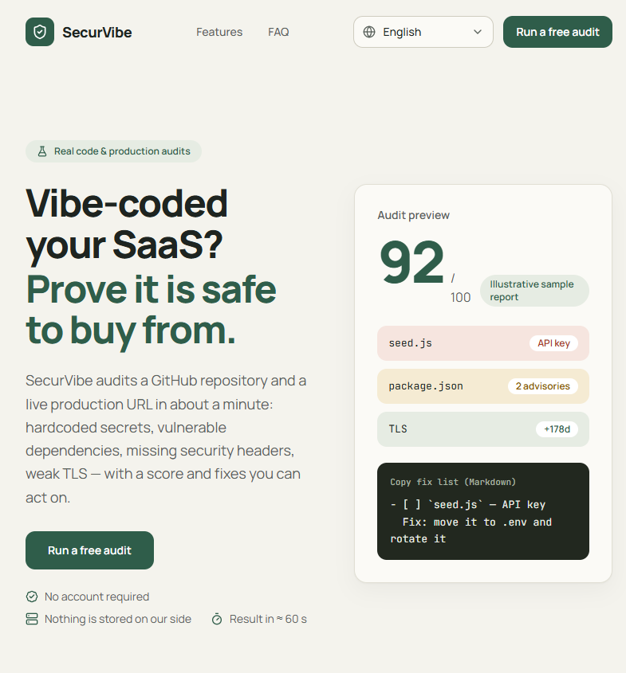

# SecurVibe

[](https://github.com/SammyYohan/SecurVibe/actions/workflows/ci.yml)
[](./LICENSE)
[](https://ko-fi.com/sammyyohan)
[](https://paypal.me/sammyyohan)

**Audits de sécurité réels pour les SaaS créés avec l'IA** — scanner GitHub + audit de production, en ≈ 60 secondes, 100 % gratuit, sans compte.

▶️ **Démo en ligne** : [securvibe-theta.vercel.app](https://securvibe-theta.vercel.app/) — lancez un audit gratuit et faites-vous votre propre avis. Sans compte.

[](https://securvibe-theta.vercel.app/)

🌍 [English](./README.md) | **Français** | [Español](./README.es.md) | [Deutsch](./README.de.md) | [Português (BR)](./README.pt-br.md) | [日本語](./README.ja.md) | [简体中文](./README.zh-cn.md) | [العربية](./README.ar.md)

> 🌐 Interface disponible en 8 langues : English · Français · Español · Deutsch · Português (BR) · 日本語 · 简体中文 · العربية (RTL).
> Les rapports d'audit (constats, correctifs) sont rédigés en anglais — standard des outils de sécurité — et s'affichent dans toutes les langues.

---

## Pourquoi j'ai créé SecurVibe

Je suis **SammyYohan** — anciennement informaticien et développeur, aujourd'hui converti au vibe coding : je construis des logiciels main dans la main avec l'IA. J'habite à Libreville, au Gabon, et je suis actuellement au chômage ; créer des projets est ce qui me fait avancer. Je suis passionné d'IA, de nouvelles technologies et de gaming — et c'est exactement de ce mélange qu'est né SecurVibe.

Le problème qu'il résout : aujourd'hui, tout le monde code avec l'IA, le plus souvent depuis une fenêtre de chat, sans aucun outil pour vérifier ce qui sort. Les bons outils de sécurité existent — plateformes CI, suites SAST, dashboards d'entreprise — mais ils visent des budgets d'entreprise. Pour un dev indépendant (ou quelqu'un sans emploi comme moi), il n'existait pas de moyen gratuit, sans inscription ni compte, de répondre à une question toute simple : *« Ce que mon IA vient de construire, est-ce vraiment prêt à être déployé ? »*

SecurVibe est la réponse : des audits réels (secrets, dépendances vulnérables, TLS, en-têtes de sécurité), un score, et une liste de correctifs prête à coller dans n'importe quel agent de code — gratuit pour tout le monde.

---

## Vérifications réelles (aucune simulation)

| Module | Ce qui est vérifié | Source de données |
| --- | --- | --- |
| **Scanner de dépôt** | Secrets en dur (PAT GitHub, clés Stripe/OpenAI/Anthropic/Slack/GitLab, AWS, PEM privés, JWT signés, URLs de base de données), priorisation par risque, jusqu'à 200 fichiers | Contenu réel via `raw.githubusercontent.com` + repli API GitHub |
| **Dépendances** | Avis CVE/GHSA réels avec niveau de gravité (OSV.dev) à partir des versions exactes résolues dans le lockfile (`package-lock.json`, `pnpm-lock.yaml`, `yarn.lock`) | [OSV.dev](https://osv.dev) (base publique gratuite, sans clé) |
| **Hygiène** | `.env` commités, exclusion `.env*` dans `.gitignore`, lockfile, workflows CI, bibliothèques de hachage (bcrypt/argon2) | Arborescence + fichiers du dépôt |
| **Audit de production** | Accessibilité HTTPS, redirection HTTP→HTTPS, certificat TLS (jours restants, handshake réel), 6 en-têtes de sécurité (CSP, HSTS, X-Frame-Options, X-Content-Type-Options, Referrer-Policy, Permissions-Policy) | Requêtes HTTP + `tls.connect` vers l'URL soumise |

**Score** : `100 − 15 × critiques − 5 × avertissements − 10 × (échec de l'étape décisive de l'audit de production)`. Un constat critique plafonne le score à 79. Chaque constat embarque une explication et un correctif copier-collable.

### Boucle de correction (100 % côté navigateur)

1. **« Analyser avec l'IA »** (optionnel) — une revue par LLM (via [OpenRouter](https://openrouter.ai)) transforme les constats en analyse claire et une instruction copier-coller pour votre agent de code.
2. **« Copier la liste de correctifs (Markdown) »** — checklist prête à coller dans Cursor / Claude Code / Copilot : chaque constat devient `- [ ]` avec son correctif, puis on ré-audite pour vérifier.
3. **Tendance locale** — le score est comparé à l'audit précédent **sur la même cible** (repo + URL de production) : `↗ +X` / `↘ −X` / `=`. Historique dans `localStorage` (50 derniers audits, aucune donnée serveur, jamais le jeton).
4. **« Ré-auditer après corrections »** — relance en un clic la même cible avec les mêmes paramètres.

---

## Stack

> 🎨 Le système de design (palette, typographie, composants) est documenté dans [`DESIGN.md`](./DESIGN.md).

- **Next.js 16** (App Router, RSC), **React 19**, **TypeScript strict**
- **Tailwind CSS v4**, lucide-react, composants UI maison (sans bibliothèque externe lourde)
- **zod** pour tous les contrats (schémas partagés client/serveur)
- Streaming **NDJSON** avec annulation propagée (`AbortSignal`/`AbortSignal.any`)
- Aucune base de données, aucun compte, aucun stockage serveur
- Quotas gérés via **Upstash Redis** (API REST stateless) avec repli mémoire automatique
- pnpm uniquement (Node ≥ 20.9)

```bash
corepack enable && corepack prepare pnpm@latest --activate
pnpm install
pnpm dev          # développement
pnpm build && pnpm start
pnpm lint && pnpm typecheck
```

---

## Structure

```
src/
├── app/
│   ├── [locale]/
│   │   ├── layout.tsx          ← layout racine (lang/dir RTL, SEO hreflang)
│   │   ├── page.tsx            ← landing (hero, bénéfices, comparatif, FAQ)
│   │   ├── pricing/page.tsx    ← redirection permanente vers /app (produit gratuit)
│   │   ├── legal/page.tsx      ← CGU & confidentialité
│   │   ├── app/page.tsx        ← dashboard (scanner)
│   │   ├── error.tsx           ← frontière d'erreur localisée
│   │   └── not-found.tsx
│   ├── api/scan/route.ts       ← POST streaming NDJSON (réel, quotas, slots)
│   ├── api/ai-analysis/route.ts← POST analyse IA optionnelle (OpenRouter)
│   └── globals.css
├── components/
│   ├── dashboard/              ← Dashboard, ScanForm, ScanStatus, SecurityReport,
│   │                             SiteAuditPanel
│   ├── site/                   ← LocaleSwitcher, SiteFooter, Logo, SectionHeading
│   └── ui/                     ← primitives maison (Button, Badge, Card, Input…)
├── lib/
│   ├── i18n/                   ← config locales, 8 dictionnaires typés, moteur
│   ├── env.ts                  ← variables serveur validées (zod)
│   ├── validation.ts           ← schémas de requête partagés (zod)
│   ├── score.ts                ← formule du score (plafond à 79 en cas de critique)
│   ├── rateLimit.ts            ← limiteur en mémoire par instance
│   ├── quota.ts                ← quotas partagés Upstash Redis + repli mémoire
│   ├── lockfile.ts             ← résolveur de versions npm, pnpm et yarn lock
│   ├── secrets.ts              ← règles de détection de secrets & conseils
│   ├── ssrf.ts                 ← validation d'URL anti-SSRF (DNS, IPs privées)
│   └── plans.ts                ← constantes de quotas et limites d'audit
├── services/
│   ├── scanService.ts          ← scanner dépôt (GitHub raw + règles + OSV.dev)
│   ├── siteService.ts          ← audit production (HTTPS, TLS, headers)
│   └── vulnClient.ts           ← client OSV.dev (batch + sévérité)
├── types/index.ts              ← contrats zod (ScanEvent, Finding, TestStep…)
└── proxy.ts                    ← redirection négociée par Accept-Language (Next 16)
```

---

## Modèle économique & Quotas d'usage loyal

SecurVibe est **100 % gratuit, sans inscription, sans publicité**.

Des quotas d'usage loyal protègent l'infrastructure et garantissent la disponibilité pour tous :

| Quota | Limite | Description |
| --- | --- | --- |
| **Par minute** | 6 audits | Fenêtre glissante par IP (anti-rafales) |
| **Par jour** | 30 audits | Par IP et par tranche UTC de 24 h |
| **Plafond global** | 1 000 audits | Par jour pour l'ensemble du service |
| **Concurrence** | 3 simultanés | Par instance de serveur (garde-fou mémoire/CPU) |
| **Profondeur** | 200 fichiers | Par audit de dépôt GitHub |

Les quotas sont vérifiés via Upstash Redis (pipeline API REST, clés préfixées `sv:`) et basculent automatiquement en mémoire locale si le store est indisponible (« fail-open »).

---

## Configuration

Toutes les variables sont **optionnelles** (voir [`.env.example`](./.env.example)) :

| Variable | Rôle |
| --- | --- |
| `GITHUB_TOKEN` | Quota serveur 60→5 000 requêtes/h quand l'utilisateur ne fournit pas le sien |
| `UPSTASH_REDIS_REST_URL` & `UPSTASH_REDIS_REST_TOKEN` | Store partagé des quotas (Upstash, API REST) |
| `OPENROUTER_API_KEY` | Optionnel : active la revue « Analyser avec l'IA » dans le rapport |
| `OPENROUTER_MODEL` | Optionnel : modèle de la revue (par défaut : `openai/gpt-4o-mini`) |
| `NEXT_PUBLIC_SITE_URL` | URL canonique + hreflang (aussi utilisée comme `HTTP-Referer` OpenRouter) |
| `CONTACT_EMAIL` | Adresse de contact affichée sur la page légale |

**Jeton utilisateur** : champ optionnel dans le formulaire de scan, transmis pour la requête courante uniquement, jamais stocké côté serveur ni client.

---

## Sécurité du produit

- Protection **anti-SSRF stricte** (`ssrf.ts`) : vérification des résolutions DNS, blocage des plages privées (10.0.0.0/8, 172.16.0.0/12, 192.168.0.0/16, 127.0.0.0/8, link-local, multicast, métadonnées cloud IPv4/IPv6), connexions sur IP épinglée pour neutraliser le DNS rebinding.
- Validation stricte **avant** tout streaming (JSON 400 sans fuite de stack trace).
- Toutes les variables d'environnement lues via un schéma zod ; secrets jamais exposés via `NEXT_PUBLIC_`.
- Limiteurs en couches (minute, jour, concurrence, global).
- Annulation propre des flux via `AbortSignal`.

---

## Déploiement (Vercel + Upstash)

1. `pnpm build` (pages pré-générées statiquement pour les 8 langues).
2. Renseigner les variables d'environnement optionnelles sur votre hébergeur (Vercel, Node…).
3. Pour les quotas partagés : [Upstash](https://upstash.com) → créer une base Redis (REST activé) → copier `UPSTASH_REDIS_REST_URL` et `UPSTASH_REDIS_REST_TOKEN`.
4. Tout est prêt : i18n, SEO (hreflang + canonique), anti-SSRF, streaming NDJSON (`maxDuration = 60` est posé pour `/api/scan`).

---

## Contribuer

Les contributions sont bienvenues :

1. Forker et créer une branche depuis `main`.
2. `pnpm install` (Node ≥ 20.9, pnpm via corepack).
3. `pnpm dev` pour l'application locale — `/en/app` est le dashboard.
4. Garder la CI verte : `pnpm typecheck && pnpm lint && pnpm build` (exécuté à chaque push/PR — voir `.github/workflows/ci.yml`).
5. Les commentaires sont en anglais ; les textes destinés aux utilisateurs passent par les 8 dictionnaires dans `src/lib/i18n/dictionaries/`.
6. Ouvrir une PR avec une description claire.

---

## Fork

Forker SecurVibe pour votre propre déploiement est exactement ce que permet la licence MIT : conservez le fichier [`LICENSE`](./LICENSE), déployez votre propre instance et restez 100 % gratuit pour vos utilisateurs — aucune mécanique de paywall n'est intégrée.

---

## Soutenir mon travail

SecurVibe est 100 % gratuit et le restera. Si l'outil vous a fait gagner du temps — ou si vous appréciez simplement ce que je construis — vous pouvez soutenir mon travail sur [Ko-fi](https://ko-fi.com/sammyyohan) ou [PayPal.me](https://paypal.me/sammyyohan).

Chaque don finance l'hébergement de cet outil et le prochain projet gratuit. Ceci est totalement optionnel : rien n'est verrouillé derrière un paiement, l'outil est complet sans cela.

---

## Licence

[MIT](./LICENSE) — libre d'utilisation, de modification et de redistribution.
