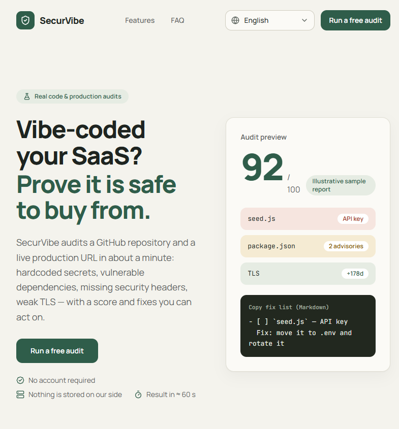

# SecurVibe

[](https://github.com/SammyYohan/SecurVibe/actions/workflows/ci.yml)
[](./LICENSE)
[](https://ko-fi.com/sammyyohan)
[](https://paypal.me/sammyyohan)

**Real security audits for AI-built SaaS** — GitHub scanner + production audit, in ≈ 60 seconds, 100% free, no account.

▶️ **Live demo**: [securvibe-theta.vercel.app](https://securvibe-theta.vercel.app/) — run a free audit and judge for yourself. No account needed.

[](https://securvibe-theta.vercel.app/)

🌍 **English** | [Français](./README.fr.md) | [Español](./README.es.md) | [Deutsch](./README.de.md) | [Português (BR)](./README.pt-br.md) | [日本語](./README.ja.md) | [简体中文](./README.zh-cn.md) | [العربية](./README.ar.md)

> 🌐 Interface available in 8 languages: English · Français · Español · Deutsch · Português (BR) · 日本語 · 简体中文 · العربية (RTL).
> Audit findings and fixes are in English — the security-tool standard — and display in every locale.

---

## Why I built SecurVibe

I'm **SammyYohan** — a former IT professional and developer who switched to vibe coding: building software hand-in-hand with AI. I live in Libreville, Gabon, and I'm currently between jobs — creating projects is what keeps me going. I'm passionate about AI, new technologies and gaming, and that mix is exactly where SecurVibe was born.

The problem it solves: today everyone ships code written with AI, usually straight out of a chat window, with no tooling to check what comes out. Solid security tooling exists — CI platforms, SAST suites, enterprise dashboards — but it targets company budgets. For an indie dev (or someone between jobs like me), there was no free, no-signup, no-account way to answer one simple question: *"Is what my AI just built actually safe to ship?"*

SecurVibe is that answer: real audits (secrets, vulnerable dependencies, TLS, security headers), a score, and a fix list made to be pasted into any coding agent — free for everyone.

---

## Real checks (no simulation)

| Module | What is checked | Data source |
| --- | --- | --- |
| **Repository scanner** | Hard-coded secrets (GitHub PATs, Stripe/OpenAI/Anthropic/Slack/GitLab keys, AWS, PEM private keys, signed JWTs, database URLs), risk-based prioritization, up to 200 files | Real content via `raw.githubusercontent.com` + GitHub API fallback |
| **Dependencies** | Real CVE/GHSA advisories with severity (OSV.dev) from the exact versions resolved in the lockfile (`package-lock.json`, `pnpm-lock.yaml`, `yarn.lock`) | [OSV.dev](https://osv.dev) (public, free, no key) |
| **Hygiene** | Committed `.env` files, `.env*` exclusion in `.gitignore`, lockfile, CI workflows, password-hashing libraries (bcrypt/argon2) | Repository tree + files |
| **Production audit** | HTTPS reachability, HTTP→HTTPS redirect, TLS certificate (days remaining, real handshake), 6 security headers (CSP, HSTS, X-Frame-Options, X-Content-Type-Options, Referrer-Policy, Permissions-Policy) | HTTP requests + `tls.connect` to the submitted URL |

**Score**: `100 − 15 × critical − 5 × warning − 10 × (decisive production-audit step failure)`. A critical finding caps the score at 79. Every finding carries an explanation and a copy-paste fix.

### Fix loop (100% in the browser)

1. **"Copy the AI instruction"** (optional) — an LLM review (via [OpenRouter](https://openrouter.ai)) turns the findings into a clear analysis and one copy-paste instruction for your coding agent.
2. **"Copy the fix list (Markdown)"** — a ready-to-paste checklist for Cursor / Claude Code / Copilot: each finding becomes a `- [ ]` item with its fix, then re-audit to verify.
3. **Local trend** — the score is compared with the previous audit **on the same target** (repo + production URL): `↗ +X` / `↘ −X` / `=`. History lives in `localStorage` (last 50 audits, no server data, never the token).
4. **"Re-audit after fixes"** — one click re-runs the same target with the same parameters.

---

## Stack

> 🎨 The design system (palette, typography, components) is documented in [`DESIGN.md`](./DESIGN.md).

- **Next.js 16** (App Router, RSC), **React 19**, **TypeScript strict**
- **Tailwind CSS v4**, lucide-react, in-house UI components (no heavy external library)
- **zod** for every contract (schemas shared client/server)
- **NDJSON** streaming with propagated cancellation (`AbortSignal`/`AbortSignal.any`)
- No database, no account, no server-side storage
- Quotas via **Upstash Redis** (stateless REST API) with automatic in-memory fallback
- pnpm only (Node ≥ 20.9)

```bash
corepack enable && corepack prepare pnpm@latest --activate
pnpm install
pnpm dev          # development
pnpm build && pnpm start
pnpm lint && pnpm typecheck
```

---

## Structure

```
src/
├── app/
│   ├── [locale]/
│   │   ├── layout.tsx          ← root layout (lang/dir RTL, hreflang SEO)
│   │   ├── page.tsx            ← landing (hero, benefits, comparison, FAQ)
│   │   ├── pricing/page.tsx    ← permanent redirect to /app (product is free)
│   │   ├── legal/page.tsx      ← terms & privacy
│   │   ├── app/page.tsx        ← dashboard (scanner)
│   │   ├── error.tsx           ← localized error boundary
│   │   └── not-found.tsx
│   ├── api/scan/route.ts       ← POST NDJSON streaming (real, quotas, slots)
│   ├── api/ai-analysis/route.ts← POST optional AI review (OpenRouter)
│   └── globals.css
├── components/
│   ├── dashboard/              ← Dashboard, ScanForm, ScanStatus, SecurityReport,
│   │                             SiteAuditPanel
│   ├── site/                   ← LocaleSwitcher, SiteFooter, Logo, SectionHeading
│   └── ui/                     ← in-house primitives (Button, Badge, Card, Input…)
├── lib/
│   ├── i18n/                   ← locale config, 8 typed dictionaries, engine
│   ├── env.ts                  ← validated server variables (zod)
│   ├── validation.ts           ← shared request schemas (zod)
│   ├── score.ts                ← score formula (capped at 79 on critical)
│   ├── rateLimit.ts            ← per-instance in-memory limiter
│   ├── quota.ts                ← shared Upstash Redis quotas + memory fallback
│   ├── lockfile.ts             ← npm/pnpm/yarn lock version resolver
│   ├── secrets.ts              ← secret detection rules & guidance
│   ├── ssrf.ts                 ← anti-SSRF URL validation (DNS, private IPs)
│   └── plans.ts                ← quota constants and audit limits
├── services/
│   ├── scanService.ts          ← repository scanner (GitHub raw + rules + OSV.dev)
│   ├── siteService.ts          ← production audit (HTTPS, TLS, headers)
│   └── vulnClient.ts           ← OSV.dev client (batch + severity)
├── types/index.ts              ← zod contracts (ScanEvent, Finding, TestStep…)
└── proxy.ts                    ← Accept-Language negotiated redirect (Next 16)
```

---

## Business model & fair-use quotas

SecurVibe is **100% free — no signup, no ads, no telemetry**.

Fair-use quotas protect the infrastructure and keep it available for everyone:

| Quota | Limit | Description |
| --- | --- | --- |
| **Per minute** | 6 audits | Sliding window per IP (burst protection) |
| **Per day** | 30 audits | Per IP, per UTC 24 h slice |
| **Global ceiling** | 1,000 audits | Per day for the whole service |
| **Concurrency** | 3 simultaneous | Per server instance (memory/CPU guardrail) |
| **Depth** | 200 files | Per GitHub repository audit |

Quotas are checked through Upstash Redis (REST pipeline, keys prefixed `sv:`) and automatically fall back to local memory when the store is unreachable ("fail-open").

---

## Configuration

Every variable is **optional** (see [`.env.example`](./.env.example)):

| Variable | Purpose |
| --- | --- |
| `GITHUB_TOKEN` | Server-side quota 60→5,000 requests/h when the user does not provide their own |
| `UPSTASH_REDIS_REST_URL` & `UPSTASH_REDIS_REST_TOKEN` | Shared quota store (Upstash, REST API) |
| `OPENROUTER_API_KEY` | Optional: enables the "Analyze with AI" review in the report |
| `OPENROUTER_MODEL` | Optional: review model (default: `openai/gpt-4o-mini`) |
| `NEXT_PUBLIC_SITE_URL` | Canonical URL + hreflang (also OpenRouter's `HTTP-Referer`) |
| `CONTACT_EMAIL` | Contact address shown on the legal page |

**User token**: optional field in the scan form, forwarded for the current request only, never stored server-side or client-side.

---

## Product security

- **Strict anti-SSRF protection** (`ssrf.ts`): DNS resolution checks, private ranges blocked (10.0.0.0/8, 172.16.0.0/12, 192.168.0.0/16, 127.0.0.0/8, link-local, multicast, cloud metadata IPv4/IPv6), pinned-IP connections to neutralize DNS rebinding.
- Strict validation **before** any streaming (JSON 400 without stack-trace leaks).
- All environment variables read through a zod schema; secrets never exposed via `NEXT_PUBLIC_`.
- Layered limiters (minute, day, concurrency, global).
- Clean stream cancellation via `AbortSignal`.

---

## Deployment (Vercel + Upstash)

1. `pnpm build` (pages statically pre-generated for the 8 locales).
2. Set the optional environment variables on your host (Vercel or Node).
3. For shared quotas: [Upstash](https://upstash.com) → create a Redis database (REST enabled) → copy `UPSTASH_REDIS_REST_URL` and `UPSTASH_REDIS_REST_TOKEN`.
4. Everything is ready: i18n, SEO (hreflang + canonical), anti-SSRF, NDJSON streaming (`maxDuration = 60` is set for `/api/scan`).

---

## Contributing

Contributions are welcome:

1. Fork and create a branch from `main`.
2. `pnpm install` (Node ≥ 20.9, pnpm via corepack).
3. `pnpm dev` for the local app — `/en/app` is the dashboard.
4. Keep the CI green: `pnpm typecheck && pnpm lint && pnpm build` (runs on every push/PR — see `.github/workflows/ci.yml`).
5. Comments are written in English; user-facing strings go through the 8 dictionaries in `src/lib/i18n/dictionaries/`.
6. Open a PR with a clear description.

---

## Forking

Forking SecurVibe for your own deployment is exactly what the MIT license is for: keep the [`LICENSE`](./LICENSE) file, deploy your own instance, and stay 100% free for your users — no paywall mechanics are built in.

---

## Support my work

SecurVibe is 100% free and will stay that way. If it saved you time — or you simply like what I build — you can support my work on [Ko-fi](https://ko-fi.com/sammyyohan) or [PayPal.me](https://paypal.me/sammyyohan).

Every donation goes into hosting costs for this tool and the next free project. Completely optional: nothing is gated behind it, the tool is complete without it.

---

## License

[MIT](./LICENSE) — free to use, modify, and redistribute.
